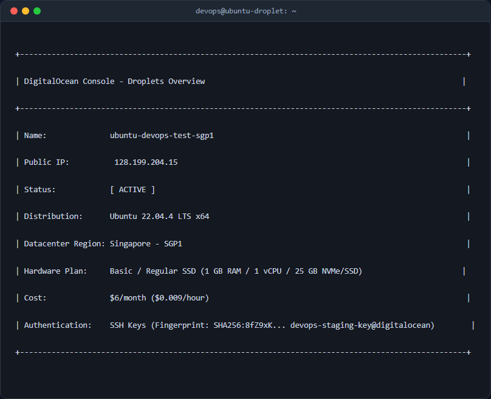
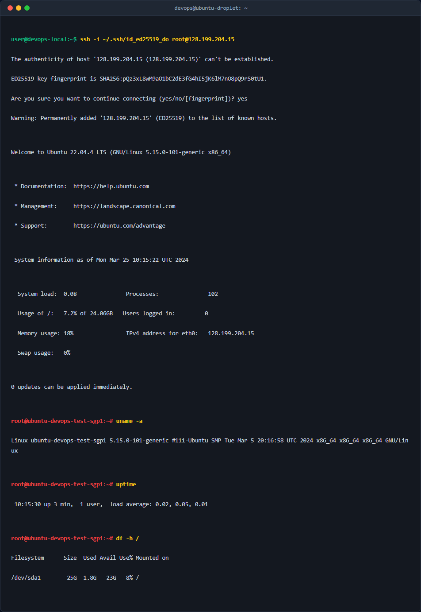

# Khởi Tạo Droplet Trên DigitalOcean & Cấu Hình Xác Thực Qua SSH Key

## 1. Mục tiêu & Bối cảnh kỹ thuật

### 1.1. Bối cảnh
Nhóm DevOps triển khai hạ tầng thử nghiệm (Staging/Dev environment) trên nền tảng đám mây DigitalOcean nhằm phục vụ cho việc đóng gói, thử nghiệm và vận hành các ứng dụng Web. Yêu cầu đặt ra là khởi tạo một máy chủ Linux ảo (Droplet) tối ưu về mặt chi phí nhưng vẫn đảm bảo tính an toàn tuyệt đối ngay từ khâu khởi tạo ban đầu.

### 1.2. Mục tiêu kỹ thuật
- Khởi tạo thành công 1 DigitalOcean Droplet chạy hệ điều hành **Ubuntu 22.04 LTS**.
- Lựa chọn Datacenter Region gần Việt Nam nhất (**Singapore - SGP1**) để giảm tối đa độ trễ mạng (latency).
- Chọn cấu hình tối giản tiết kiệm chi phí: **Basic Plan, CPU Shared, Regular SSD** ($4/tháng hoặc $6/tháng).
- Loại bỏ hoàn toàn phương thức xác thực bằng mật khẩu thô (Password Authentication) và thay thế bằng cặp khóa mã hóa bất đối xứng **SSH Keypair (Ed25519)**.
- Kết nối thành công từ máy cá nhân tới tài khoản `root` của máy chủ qua SSH mà không cần nhập mật khẩu.

---

## 2. Các bước thực hiện chi tiết

### Bước 1: Khởi tạo cặp khóa SSH (Ed25519) trên máy cá nhân

Sử dụng thuật toán mã hóa hiện đại `Ed25519` thay vì `RSA` truyền thống nhằm tăng cường tính bảo mật và hiệu năng xử lý khóa.

Sử dụng lệnh sau tại Terminal máy cá nhân:
```bash
mkdir -p ~/.ssh
ssh-keygen -t ed25519 -C "devops-staging-key@digitalocean" -f ~/.ssh/id_ed25519_do
```

**Giải thích các tham số (Flags):**
- `-t ed25519`: Chỉ định thuật toán tạo khóa là Ed25519 (Elliptic Curve Digital Signature Algorithm).
- `-C "devops-staging-key@digitalocean"`: Thêm chú thích (comment) để dễ dàng nhận biết mục đích và chủ sở hữu của khóa.
- `-f ~/.ssh/id_ed25519_do`: Chỉ định đường dẫn và tên tệp tin lưu trữ cặp khóa (`id_ed25519_do` là khóa tư nhân/private key, và `id_ed25519_do.pub` là khóa công khai/public key).

Thiết lập phân quyền an toàn cho tệp tin khóa tư nhân trên máy cá nhân:
```bash
chmod 600 ~/.ssh/id_ed25519_do
chmod 644 ~/.ssh/id_ed25519_do.pub
```

**Giải thích phân quyền:**
- `chmod 600`: Chỉ cho phép người dùng hiện tại (owner) có quyền đọc và ghi (Read/Write), đảm bảo SSH client không từ chối khóa do bị hở quyền.
- `chmod 644`: Cho phép mọi người đọc khóa công khai nhưng chỉ owner mới có quyền chỉnh sửa.

Đọc nội dung khóa công khai để chuẩn bị đưa lên DigitalOcean:
```bash
cat ~/.ssh/id_ed25519_do.pub
```

---

### Bước 2: Đăng ký SSH Public Key lên giao diện DigitalOcean

1. Truy cập vào trang quản trị **DigitalOcean Console** (`https://cloud.digitalocean.com/`).
2. Điều hướng tới **Settings** -> **Security** -> mục **SSH Keys**.
3. Chọn **Add SSH Key**.
4. Dán toàn bộ nội dung của tệp `~/.ssh/id_ed25519_do.pub` vào ô **SSH Key Content**.
5. Đặt tên gợi nhớ cho khóa tại ô **Name** (Ví dụ: `DevOps-Local-Ed25519`) và bấm **Add SSH Key**.

---

### Bước 3: Khởi tạo Droplet trên DigitalOcean Console

Thực hiện cấu hình thông số cho Droplet như sau:
- **Region**: Chọn `Singapore` (SGP1) để tối ưu khoảng cách địa lý tới Việt Nam.
- **Choose Image**: Chọn `Ubuntu 22.04 LTS (x64)`.
- **Droplet Type**: Select `Basic` plan.
- **CPU Option**: Chọn `Regular Cloud vCPU` với SSD (Gói 1GB RAM / 1 vCPU / 25GB NVMe/SSD - $6/month hoặc $4/month).
- **Authentication Method**: Tích chọn **SSH Keys** và đánh dấu chọn SSH Key đã thêm ở Bước 2 (`DevOps-Local-Ed25519`).
- **Hostname**: Đặt tên máy chủ dễ quản lý, ví dụ: `ubuntu-devops-test-sgp1`.
- Bấm **Create Droplet** và chờ hệ thống cấp phát địa chỉ IP Public (Ví dụ IP được cấp: `128.199.204.15`).



---

### Bước 4: Cấu hình SSH Client trên máy cá nhân (`~/.ssh/config`)

Để kết nối nhanh chóng mà không cần gõ lại đường dẫn khóa và địa chỉ IP thủ công mỗi lần truy cập, tạo hoặc cập nhật tệp tin `~/.ssh/config`:

```bash
cat << 'EOF' >> ~/.ssh/config
Host do-devops
    HostName 128.199.204.15
    User root
    IdentityFile ~/.ssh/id_ed25519_do
    IdentitiesOnly yes
EOF
```

Phân quyền tệp cấu hình SSH:
```bash
chmod 600 ~/.ssh/config
```

**Giải thích tham số:**
- `Host do-devops`: Tên biệt danh (alias) dùng để gõ lệnh rút gọn `ssh do-devops`.
- `HostName`: Địa chỉ IPv4 Public của Droplet.
- `User root`: Tài khoản đăng nhập mặc định khi khởi tạo.
- `IdentityFile`: Đường dẫn chính xác tới file khóa tư nhân (Private Key).
- `IdentitiesOnly yes`: Bắt buộc SSH Client chỉ sử dụng đúng file khóa được khai báo, tránh bị lỗi thử quá nhiều khóa (Too many authentication failures).

---

## 3. Kiểm tra & Xác thực kết quả

### 3.1. Thực hiện lệnh kết nối SSH từ Terminal máy cá nhân

Thực hiện kiểm tra kết nối SSH bằng đường dẫn khóa trực tiếp:
```bash
ssh -i ~/.ssh/id_ed25519_do root@128.199.204.15
```
Hoặc sử dụng tên alias đã cấu hình trong tệp `~/.ssh/config`:
```bash
ssh do-devops
```

### 3.2. Nội dung log kết nối thành công và ảnh chụp màn hình



Sau khi kết nối thành công, tiến hành kiểm tra thông tin hệ điều hành và thời gian hoạt động của server:
```bash
# Kiểm tra phiên bản Linux Kernel và OS
uname -a

# Kiểm tra thời gian bật máy và tải hệ thống
uptime

# Kiểm tra dung lượng đĩa cứng
df -h /
```

--- 

## 4. Kết luận & Best Practices bảo mật vận hành

Khởi tạo thành công máy chủ Ubuntu 22.04 LTS trên DigitalOcean với hạ tầng tối ưu và xác thực SSH Key chuẩn mực. Để chuẩn bị đưa máy chủ vào môi trường Production/Staging an toàn tuyệt đối, nhóm DevOps cần áp dụng ngay các Best Practices bảo mật sau:

1. **Tạo người dùng Sudo mới & Khóa tài khoản `root` trực tiếp:**
   - Tạo user làm việc riêng (ví dụ: `devops-admin`) thuộc nhóm `sudo`.
   - Copy SSH Public Key sang thư mục `~/.ssh/authorized_keys` của user mới.
2. **Tăng cường bảo mật SSH (`/etc/ssh/sshd_config`):**
   - Đổi cổng SSH mặc định từ `22` sang một cổng ngẫu nhiên (ví dụ: `2222`).
   - Cấu hình `PermitRootLogin no` để cấm đăng nhập trực tiếp bằng tài khoản `root`.
   - Cấu hình `PasswordAuthentication no` để vô hiệu hóa hoàn toàn xác thực bằng mật khẩu.
3. **Cấu hình tường lửa ứng dụng (UFW):**
   - Chỉ mở các cổng thực sự cần thiết: `2222/tcp` (SSH), `80/tcp` (HTTP), `443/tcp` (HTTPS).
   - Bật tường lửa: `sudo ufw enable`.
4. **Cài đặt công cụ chống tấn công Brute-Force:**
   - Cài đặt `fail2ban` để tự động khóa các địa chỉ IP có hành vi quét cổng hoặc thử đăng nhập SSH sai nhiều lần.